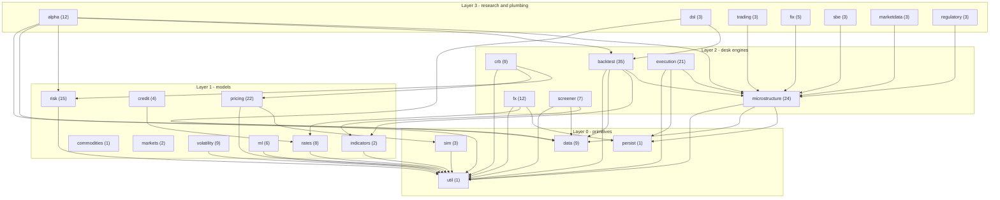
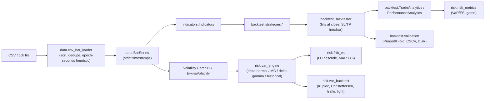

# Architecture

Package map and dependency structure of `quantfinlib` (223 modules
under `src/quantfinlib/`, 26 packages). Every arrow in the diagram was
derived from the actual `from quantfinlib.<pkg> import ...` statements
in the source tree (`grep -rn "quantfinlib\." src/`), not from intent;
the module counts exclude `__init__.py`.

## Layering

The library is a strict DAG, four layers deep. Nothing imports upward,
and the only "hub" below the research layer is `microstructure`, whose
`execution.py` (`Side`, `Execution`) is the shared order/fill vocabulary
that the wire-format, trading and regulatory packages all speak.

| Layer | Packages | Depends on |
|---|---|---|
| 0 -- primitives | `util` (`math_utils`), `sim` (`_java_random`, `MonteCarloSimulator`), `persist` (`Checkpoint`), `data` | `util` only (`persist` and `data` are leaves) |
| 1 -- models | `pricing`, `rates`, `credit`, `commodities`, `markets`, `risk`, `volatility`, `indicators`, `ml` | `util`; `pricing` also uses `sim` (the SABR calibration RNG); `credit` uses `rates` |
| 2 -- desk engines | `microstructure`, `fx`, `crb`, `backtest`, `screener`, `execution` | layer 0-1; `backtest` and `execution` use `microstructure`; `crb` uses `pricing` + `risk`; `fx` uses `rates` + `persist` |
| 3 -- research & plumbing | `alpha`, `dsl`, `trading`, `fix`, `sbe`, `marketdata`, `regulatory` | `alpha` sits on `backtest` + `risk` + `microstructure`; `dsl` on `backtest`; the wire/venue packages only need `microstructure.execution.Side` |

## Dependency diagram

`commodities` and `markets` import nothing from the rest of the library
(pure closed forms over NumPy), which is why they have no outgoing
arrows.

## Package map

Module counts in parentheses; the class named is the one to read first.

**Layer 0**
- `util` (1) -- `math_utils`: 27 public numerical primitives (mean/variance two-pass, `percentile`, `cholesky` with the Java pivot rule, Acklam `norm_inv`, A&S `norm_cdf`, Lanczos `log_gamma`, Lentz `regularized_incomplete_beta`, `t_cdf`, `pair_sort`). The `not (x > 0)` NaN-rejecting gate idiom lives here and is copied everywhere.
- `sim` (3) -- `_java_random.SplittableRandom64` (bit-exact `java.util.SplittableRandom`), `MonteCarloSimulator`, `SimulationResult`.
- `persist` (1) -- `Checkpoint`: byte-identical to the Java file format; `LpScorecard`, `EwmaCovariance`, `VolumeCurve` snapshot into it.
- `data` (9) -- `Bar`, `BarSeries` (structure-of-arrays, read-only views, strictly increasing timestamps), `csv_bar_loader`, `series_aligner`, `corporate_actions`, `point_in_time_universe`, QFLT tick reader/writer.

**Layer 1**
- `pricing` (22) -- `BlackScholes` (+`Greeks`, `implied_vol`), `Black76`, `HigherOrderGreeks`, `IncrementalGreeks`, `BinomialTree`, `DigitalOption`, `BarrierOption`, `TouchOption`, `VannaVolga`, `ExchangeOption` (Margrabe/Kirk), `QuantoOption`, `VarianceSwap`, `AsianOption`, `StructuredNotes`, `Autocallable`, `Heston`, `SabrModel`, `VolSurface`, `ForwardCurve`, `DividendSchedule`, `FairValueEngine`, `TriangularArbitrage`.
- `rates` (8) -- `YieldCurve`, `BondPricer`, `NelsonSiegel`, `Svensson`, `SwapPricer`, short-rate models (Vasicek/CIR/Hull-White), `KeyRateDurations`, `rates_options` (swaptions/caps).
- `credit` (4) -- `CreditCurve`, `CdsPricer`, `credit_spreads` (Z-spread), `CvaApproximator`.
- `commodities` (1) -- `CommodityCurve`.
- `markets` (2) -- `IndexConstruction`, `PrivateMarketAnalytics`.
- `risk` (15) -- `risk_metrics`, `var_engine`, `component_var`, `covariance_shrinkage` (Ledoit-Wolf), `extreme_value_theory`, `stress_tester`, `frtb_es`, `pnl_attribution`, `var_backtest`, `pca`, `gaussian_copula`, `dependence`, `concentration_risk`, `counterparty_exposure_tracker`, `settlement_risk_analyzer`.
- `volatility` (9) -- `EwmaVolatility`, `Garch11`, `GjrGarch11`, `Egarch11`, `HarRv`, `volatility_index`, `range_volatility`, `information_criteria`, `volatility_decomposition`.
- `indicators` (2) -- `Indicators` (batch), `streaming_indicators`.
- `ml` (6) -- `GradientBoostedRegressor`, `regime_detector` (HMM `RegimeModel`), `anomaly_detector` (quote stuffing, price spikes), `VolatilityForecaster`, `MarketImpactPredictor`, `IntradayLiquidityForecaster`.

**Layer 2**
- `microstructure` (24) -- `execution` (`Side`, `Execution`: the shared vocabulary), `AlmgrenChriss`, `KylesLambda`, `OrnsteinUhlenbeck`, `VarianceRatio`, `LeadLagEstimator`, `TransactionCostAnalyzer`, `MarketImpactModel`, `VolumeCurve`/`VolatilityCurve`/`DayTypeProfiles`, `QueueModel`, `QueuePositionEstimator`, `FillProbabilityModel`, `TradeClassifier` (Lee-Ready), `FlowSignals`, `Vpin`, `HawkesIntensity`, `EwmaCovariance`, `AvellanedaStoikov`, `SpreadForecaster`, `HiddenLiquidityDetector`, `LiquidityMeasures`, `jump_robust_volatility`.
- `fx` (12) -- `CurrencyPair`, `BusinessCalendar`, `SwapPointsCurve`, `FxSwap`, `Ndf`, `FxVolSurface`, `FxTierBook`, `AggregatedBook`, `LpScorecard`, `LpRouter`, `SyntheticCross`, `FixingRisk`.
- `crb` (9) -- `FactorRegistry`, `CentralRiskBook`, `SkewedQuoter`, `InternalizationEngine`, `HedgeOptimizer`, `CrbHedgeUniverse`, `CrbAutoHedger`, `CrbRouter`, `CrbPnlLedger`.
- `backtest` (35) -- core: `Backtester`, `BacktestConfig`, `TradingStrategy`, `Signal`, `Trade`, `TradeCostModel`, `execution_models`, `ExecutionAwareBacktester`, `ParentOrder`, `TradeAnalytics`, `PerformanceAnalytics`, `DrawdownAnalytics`, `BenchmarkComparison`; `strategies/` (SMA/EMA cross, RSI, MACD, Bollinger); `validation/` (`PurgedKFold`, `OverfitProbability`, `BlockBootstrap`, `SharpeValidation`, `MonteCarloTradeShuffle`, `WalkForwardAnalyzer`, `GridSearchOptimizer`, `ParameterGrid`); `portfolio/` (`PositionSizing`, `PortfolioOptimizer`, `RiskParityOptimizer`, `BlackLitterman`, `ConstrainedPortfolioOptimizer`, `PortfolioBacktester`, `PortfolioStrategy`, `CrossSectionalMomentum`).
- `screener` (7) -- `StockScreener`, `StockSnapshot`, `Fundamentals`, filters, `RankingEngine`.
- `execution` (21) -- `twap_scheduler`, `vwap_scheduler`, `PovTracker`, `implementation_shortfall_scheduler` (Almgren-Chriss trajectory), `wmr_fixing_scheduler`, `HftSor`, `AdaptiveSor`, `Ucb1Selector`, `DarkPoolSimulator`, `BenchmarkExecutor`, `SpreadExecutionAlgo`, `FuturesRollAlgo`, `IcebergOrder`, `LiquiditySeekingAlgo`, `MidPegTracker`, `order_placement_policy`, `AntiGamingJitter`, `PortfolioExecutor`, `Slice`, `VenueQuote`, `VenueScorecard`.

**Layer 3**
- `alpha` (12) -- `AlphaContext`, `AlphaFactor` + `factors`, `SignalEvaluator`, `AlphaValidation`, `AlphaBacktester`, `PortfolioConstruction`, `AlphaReport`, `AlphaEnsemble`, `OnlineAlphaLearner`, `FamaMacBeth`, `CalendarAnomalies`.
- `dsl` (3) -- `StrategyBuilder`, `Rule`, `rules` (the no-lookahead builder).
- `trading` (3) -- `OrderThrottle`, `LastLookGate`, `PaperTradingGateway`.
- `fix` (5) -- `FixMessage`, `fix_parse`, `FixDecoder`, `FixOrderEncoder`, `FixExecReportView`.
- `sbe` (3) -- order/quote/trade flyweights (byte-exact).
- `marketdata` (3) -- `itch_codec` (`ItchView` + encoders), `L3BookBuilder`, `Nbbo`.
- `regulatory` (3) -- `BestExecutionAnalyzer`, `fix_analyzer` (`FixImpactReport`), `market_quality_metrics` (quoted/effective/realized spread, price impact).

## Data flow through a typical study

## Invariants the layering enforces

1. **Validation happens at the boundary.** Every public function in
   layers 0-1 validates its own inputs (finite, non-empty, sorted where
   order matters) and raises `ValueError`; layer 2-3 code may assume
   clean numbers once a layer-1 call has returned.
2. **`microstructure.execution.Side` is the only shared enum** across
   the wire-format, trading, execution and regulatory packages; no
   package defines a second buy/sell type.
3. **RNG discipline.** `sim._java_random` is the one bit-exact Java
   stream; `pricing.sabr_model` imports it rather than carrying a copy.
   Everything else uses `numpy.random.default_rng(seed)` and pins
   distribution properties, stated per docstring.
4. **`persist.Checkpoint` is a leaf.** Classes opt in (`LpScorecard`,
   `EwmaCovariance`, `VolumeCurve`); the checkpoint module never imports
   the classes it serialises.
5. **No threads, no sockets.** Nothing under `src/` spawns a thread or
   opens a network connection; the live layer is Java/C++ territory.
